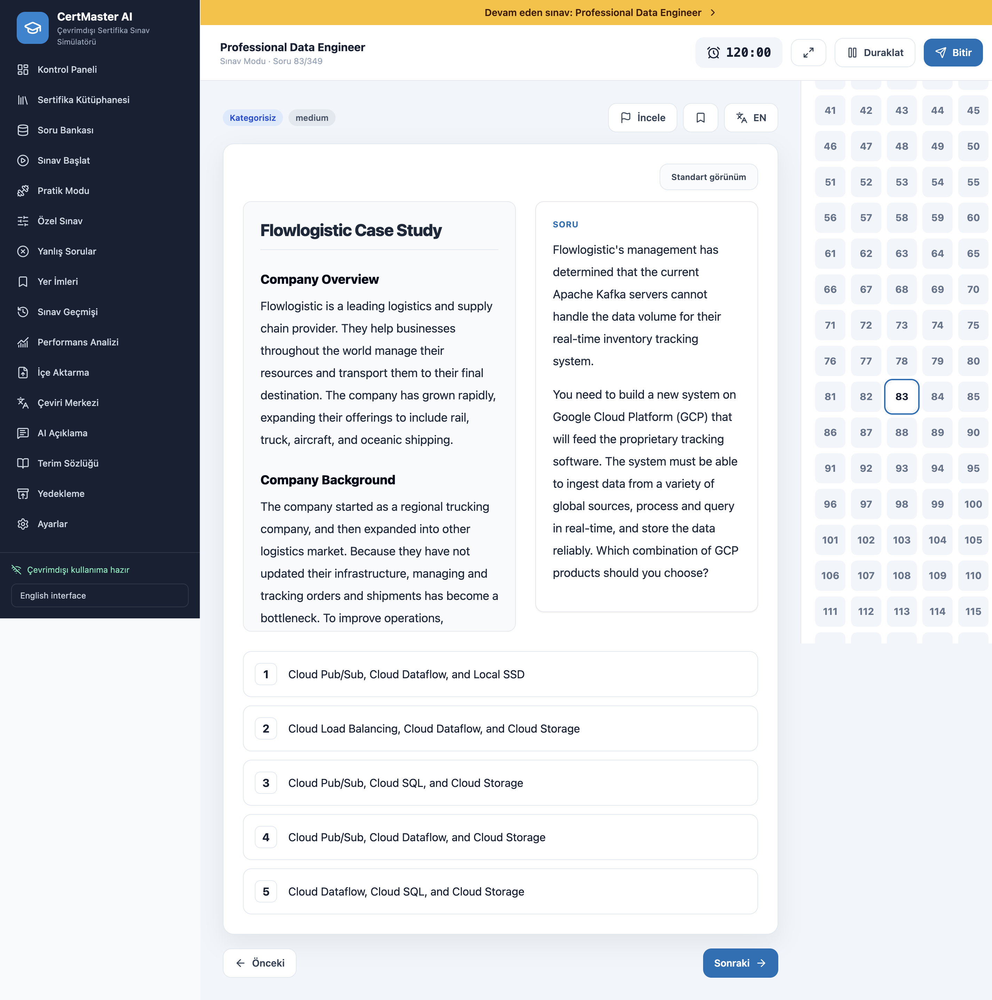
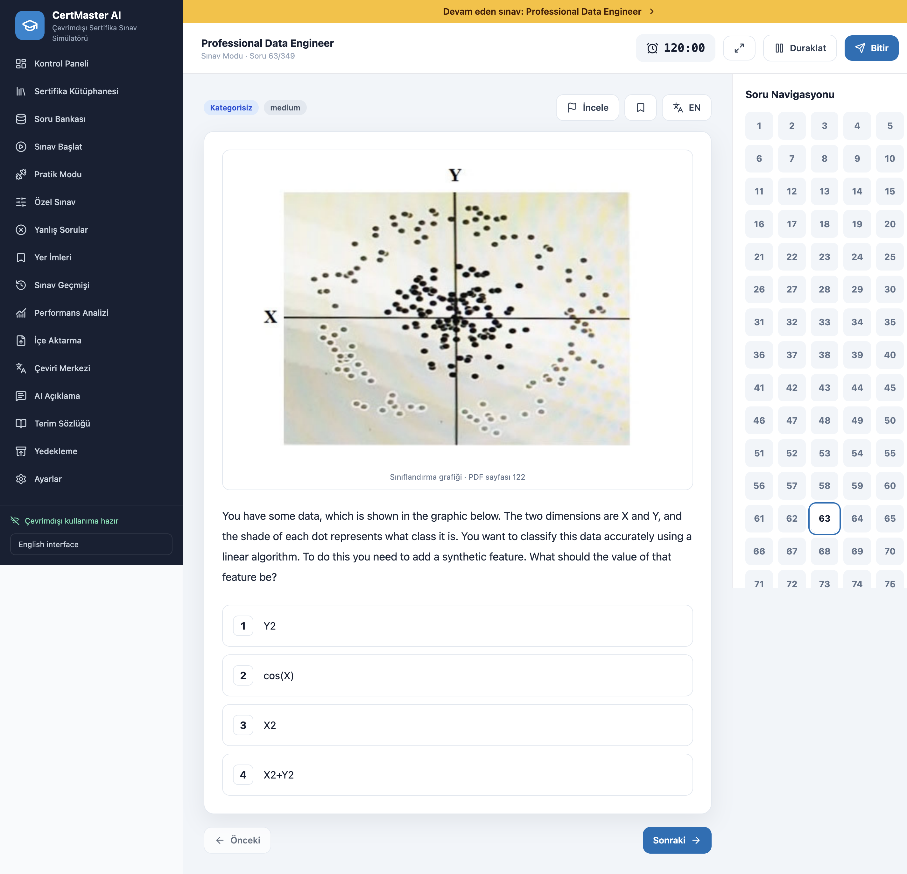
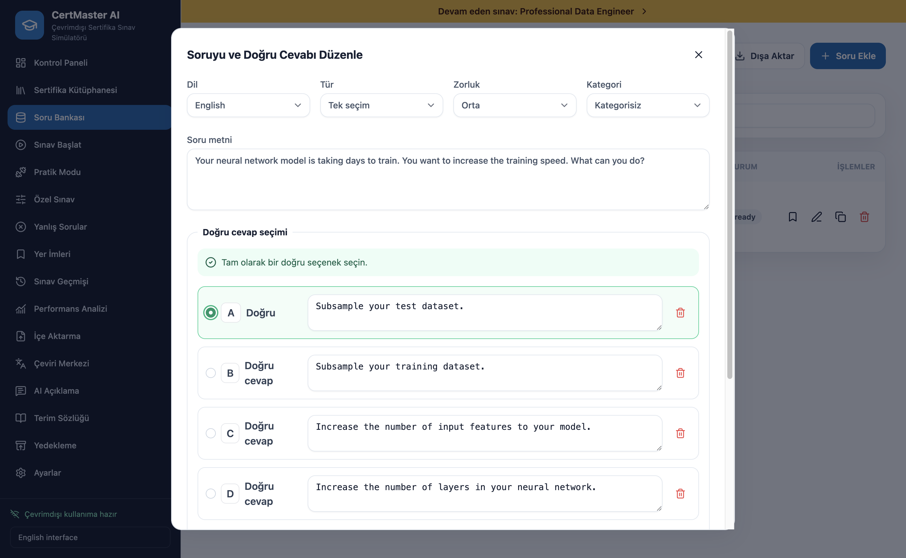
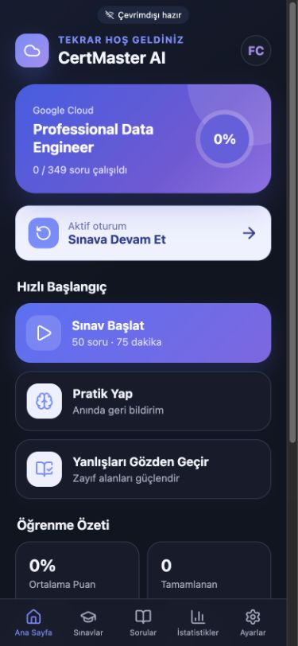
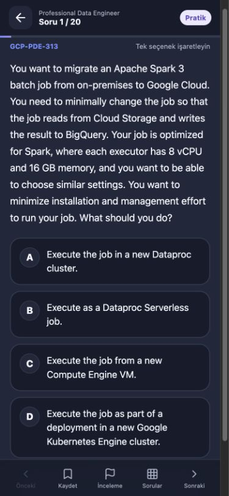
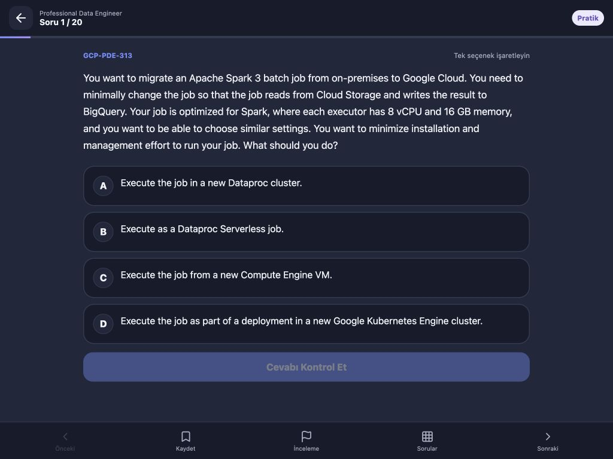

# CertMaster AI – Offline Certification Exam Simulator

[](https://github.com/farukcevik/certmaster-ai/actions/workflows/release.yml)

## Download

Installers are attached to [GitHub Releases](https://github.com/farukcevik/certmaster-ai/releases). Each release provides:

- `CertMaster-AI-VERSION-mac-arm64.dmg` — Apple Silicon Macs
- `CertMaster-AI-VERSION-mac-x64.dmg` — Intel Macs
- `CertMaster-AI-VERSION-win-x64-setup.exe` — Windows 10/11 x64
- `SHA256SUMS-*.txt` — installer integrity checksums

No release is currently published automatically. The release workflow creates a draft after every mandatory build and test succeeds; a maintainer must review and publish it. Unsigned testing builds may trigger macOS Gatekeeper or Windows SmartScreen warnings.

CertMaster AI is an offline-first Electron desktop application for importing, managing, translating, and practicing certification questions. The primary UI is Turkish, with English UI support and independent English/Turkish/bilingual question display.

An additional Capacitor iOS application is under development on `feature/ios-app`. It provides a touch-first iPhone/iPad interface, native SQLite persistence, offline bundled questions, resumable exams, practice validation, analytics, bookmarks, and Files/Share Sheet backup. See [iOS setup](docs/IOS_SETUP.md).

The repository includes the user-authorized, locally extracted Google Cloud Professional Data Engineer bank at `question-banks/GCP_PDE_349_questions.json`, together with its recovered question images. Stable source identifiers make imports idempotent, and no question content is downloaded at runtime.

## Screenshots

| Structured case study | Image-based question | Correct-answer editor |
| --- | --- | --- |
|  |  |  |

### iOS development preview

| iPhone dashboard | iPhone practice | iPad practice |
| --- | --- | --- |
|  |  |  |

## Supported systems

| System | Package | Release build runner | Runtime validation |
| --- | --- | --- | --- |
| macOS Apple Silicon | arm64 DMG | `macos-latest` | Only when runner architecture is arm64 |
| macOS Intel | x64 DMG | `macos-latest` | Only when runner architecture is x64 |
| Windows 10/11 | x64 NSIS installer | `windows-latest` | Packaged app is launched with Playwright |

End users do not need Node.js, pnpm, Git, a compiler, or a terminal.

## Installation

### macOS

1. Download the DMG matching **Apple Silicon** or **Intel** from GitHub Releases.
2. Verify its SHA-256 digest against the matching checksum file.
3. Open the DMG and move **CertMaster AI** to Applications.
4. For an unsigned testing build, use **System Settings → Privacy & Security → Open Anyway** after confirming the checksum and source.

### Windows

1. Download `CertMaster-AI-VERSION-win-x64-setup.exe`.
2. Verify its SHA-256 digest against `SHA256SUMS-win-x64.txt`.
3. Run the installer and choose the installation directory.
4. Unsigned testing builds can show a SmartScreen warning; verify the checksum before continuing.

CertMaster AI stores its SQLite database in the operating system application-data directory and works without an internet connection or account.

## Implemented capabilities

- Secure Electron shell: context isolation, sandboxed CommonJS preload, renderer Node.js disabled, sender-validated/Zod-validated IPC, navigation blocking, and file-dialog capability grants.
- Normalized SQLite storage with WAL journaling, foreign keys, indexes, transactional writes, migrations, integrity checks, backup, and restore.
- Certification/provider library and complete question CRUD with single, multiple, true/false, scenario, and image question types.
- Exam, practice, custom, incorrect-question, and bookmarked-question session creation.
- Inclusive question-range exams with 10/20/25/50-question presets, custom ranges, ordered/shuffled question modes, per-group completion scores, and mandatory per-session option shuffling.
- Exact exam retakes from results and history: the question set/order, mode, and duration are retained while answers are cleared and option order is regenerated.
- Countdown, pause/resume, automatic progress persistence, answer/option randomization, review flags, navigation grid, automatic timeout submission, and restart recovery.
- Results, history, question review, daily activity, score trends, category accuracy, and weak-topic reporting.
- Local JSON/CSV/PDF text import preview, duplicate detection, manual correction, partial selection, and explicit OCR-required detection.
- Turkish/English UI localization and English/Turkish/bilingual question display without resetting the session.
- Local translation cache, manual editing/approval, configurable terminology, protected-segment validation, Ollama, Gemini, and OpenAI provider abstraction.
- OS-backed Electron `safeStorage` for cloud API credentials. Cloud AI is disabled by default and requires explicit content-sharing authorization.
- Full local SQLite backup/restore with pre-restore integrity and schema validation.
- Unit, integration, React Testing Library, and Electron Playwright tests.

## Developer requirements

- Node.js 22 or later
- pnpm 10 or later
- macOS 12+ (Apple Silicon or Intel) or Windows 10+
- Xcode Command Line Tools on macOS when a native SQLite prebuild is unavailable

Ollama is optional. No AI component is required for exam functionality.

## Install and develop

```bash
pnpm install
pnpm dev
```

The first install builds `better-sqlite3` for the current platform. Development data is stored under Electron's platform-specific application data directory, never in the repository.

## Validation

```bash
pnpm typecheck
pnpm run test:unit
pnpm run test:e2e
pnpm build
```

`test:e2e` builds the application and rebuilds native dependencies for Electron before launching a temporary isolated profile.

## Build and distribution

```bash
# Current platform
pnpm package

# macOS arm64 + x64 DMGs (must run on macOS)
pnpm package:mac

# Individual macOS architectures
pnpm package:mac:arm64
pnpm package:mac:x64

# Windows x64 NSIS installer (prefer running on Windows CI/host)
pnpm package:win
```

Unsigned local macOS packages are suitable for testing. Public distribution requires an Apple Developer ID certificate and notarization credentials. Windows signing similarly requires a code-signing certificate.

Version tags such as `v1.0.0` trigger [.github/workflows/release.yml](.github/workflows/release.yml). Builds run on native GitHub runners, rebuild `better-sqlite3` for the target Electron ABI, execute mandatory validation, generate SHA-256 files, and create a draft GitHub Release. See [Release process](docs/RELEASING.md).

## Import Google Cloud Professional Data Engineer questions

1. Obtain an authorized PDF, JSON, or CSV source. Do not import material you are not licensed to use.
2. Open **İçe Aktarma** and select **Google Cloud — Professional Data Engineer**.
3. Choose PDF, JSON, or CSV. All extraction happens locally.
4. Review every parser warning. A source without detectable correct answers is never guessed; affected questions are marked for review and are skipped until corrected.
5. Correct question text/options and select the correct answer in the preview.
6. Deselect unwanted records and choose **Seçilen Soruları İçe Aktar**.
7. Use **Soru Bankası** to assign categories, tags, and final approval state.

For an approximately 349-question source, JSON is the most reliable format. The supported schema is documented in [docs/IMPORT_SCHEMA.md](docs/IMPORT_SCHEMA.md).

The integrated bank contains 349 validated records: 329 single-answer, 19 multiple-answer, and one image-answer question. All three required source visuals have been recovered; no current record is flagged for missing image content.

The authorized source PDF was matched deterministically by `GCP-PDE-001` through `GCP-PDE-349`. It contains an original explanation section for 195 questions; the remaining 154 questions are intentionally left without an explanation rather than receiving generated content. The reproducible audit is stored in `reports/pde-explanation-recovery.json`. Existing desktop databases receive source explanation/correctness updates by stable identifier without replacing question/option IDs, history, attempts, bookmarks, or translations.

Long PDF questions retain both their immutable normalized text and a versioned structured document. The exam reader renders case-study headings, paragraphs, nested lists, code blocks, tables, and image notices without executing HTML. Case studies offer standard and independently scrollable split views.

Required source visuals are stored directly in the structured question document as offline data images. The integrated PDE bank includes the classification graphic for Q63, all four SQL image options for Q243, and the sample BigQuery table for Q248. In **Soru Bankası → Düzenle**, the **Doğru cevap seçimi** section uses radio controls for single-answer questions and checkboxes for multiple-answer questions; saving preserves the stable question and option identifiers.

To recover formatting for an already imported 349-question database without deleting user data:

```bash
node dist-electron/electron/scripts/reprocessPdeFormatting.js \
  /path/to/professional-data-engineer.pdf \
  /path/to/certmaster.db \
  reports/pde-formatting-recovery.json
```

The command creates a timestamped database backup, matches `GCP-PDE-001` through `GCP-PDE-349`, updates formatting fields in one transaction, and verifies that questions, options, correct answers, history, attempts, bookmarks, and translations are unchanged.

## Documentation

- [Architecture](docs/ARCHITECTURE.md)
- [Database](docs/DATABASE.md)
- [AI setup and privacy](docs/AI_SETUP.md)
- [Import schema](docs/IMPORT_SCHEMA.md)
- [Question formatting recovery](docs/QUESTION_FORMATTING.md)
- [Troubleshooting](docs/TROUBLESHOOTING.md)
- [Release process](docs/RELEASING.md)
- [iOS setup and physical-device installation](docs/IOS_SETUP.md)
- [Security policy](SECURITY.md)
- [Changelog](CHANGELOG.md)

## Known limitations

- OCR is deliberately not bundled. Image-only PDFs are detected and reported; they must be OCRed before import.
- PDF text parsing supports common numbered-question layouts but cannot reliably infer arbitrary publisher layouts. Missing answers are never fabricated.
- Embedded PDF image extraction and question-image editing are represented in the database schema but are not yet exposed by the importer UI.
- Bulk AI translation currently processes one selected question at a time; manual translation and local caching are complete, while resumable batch job controls are not yet exposed in the UI.
- A macOS host cannot runtime-validate Windows. Windows runtime validation is performed only by the `windows-latest` GitHub Actions job.
- macOS packages are runtime-tested only when the target matches the architecture of the selected GitHub runner; the other architecture is build- and structure-validated.
- Signing and notarization require maintainer-provided GitHub Actions secrets. Builds without them are explicitly treated as unsigned testing builds.

## Data and privacy

Core features never require a network connection. Ollama connects only to the configured local endpoint. Gemini/OpenAI calls are blocked until the user enables cloud AI, stores a credential, and explicitly authorizes sending question content. There is no registration, telemetry, cloud sync, or automatic upload.
